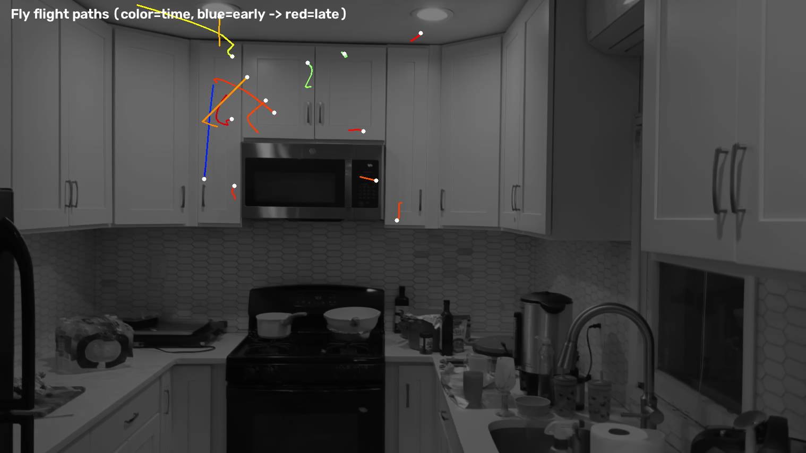

# 🪰 Fly Tracking via Motion Amplification

Tracking houseflies in handheld phone footage of a kitchen, using motion amplification + classic computer-vision tracking. First pass of a larger project on *the most effective systems for tracking small objects in video*.

**Source clip:** 1518×854, 30 fps, 20 s — phone held flat against a wall looking into a kitchen; a few flies in the air.

---

## Headline results

- **14 clean fly flight-tracks** recovered across the clip.
- Flies = **small dark specks (~2–40 px²)** moving against the bright white cabinets; confirmed real by frame-to-frame motion and by clustering in the upper third of the frame (where flies actually hang out).
- **Max 2 flies airborne at once** — they mostly appear one at a time.
- **Motion-amplification finding:** detecting on the *raw* video with an adaptive background subtractor (**14 tracks**) beat detecting on the *motion-amplified* video (**12 tracks, shorter**). Motion-amp is a great human-review layer but a poor detection pre-filter — it halves contrast and adds a ghost that fragments tiny blobs.



---

## What's here

```
videos/    5 result videos (H.264, play anywhere)
figures/   key stills (path map, mesh, voxel 3D, diagnostic masks)
scripts/   the full pipeline, one file per stage
data/      final tracks + intermediate arrays (JSON/NPY)
source/    the original input clip (so it's reproducible)
REPORT.md  full write-up: every step, library, trick, and next steps
```

### Videos
| File | What |
|---|---|
| `01_motion_amplification.mp4` | The inverted/time-shifted overlay — static scene cancels to flat gray, only motion shows |
| `02_motion_amp_heatmap.mp4` | 6× amplified motion + heatmap (shows the noise problem) |
| `03_tracking_coordinates.mp4` | Coordinate-array trajectories + live markers + IDs |
| `04_tracking_mesh.mp4` | Delaunay mesh of concurrent flies + Kalman velocity vectors |
| `05_voxel_spacetime_3d.mp4` | Rotating 3D (x, y, time) voxel/space-time view |

---

## The pipeline that worked

1. **Trim** the 2.6 s of opening camera shake.
2. **Don't stabilize** — footage was already stable; stabilizing *added* jitter.
3. **Temporal-instability mask** (streaming Welford per-pixel std) to kill edge-jitter + the flickering microwave clock.
4. **MOG2 adaptive background** — beats a fixed median; absorbs the slow hand-settling drift in the first ~5 s.
5. **Shape filter** (compact, round, small) to drop thin edge streaks.
6. **Kalman + Hungarian tracking** — the real noise filter: a fly *moves*, jitter sits still.
7. **Motion-based track filtering** → keep only tracks that actually translate.

## Stack

OpenCV 5 · NumPy · SciPy (`linear_sum_assignment`, `Delaunay`) · Matplotlib (3D) · scikit-image · FFmpeg.

## Reproduce

```bash
python3 -m venv env && . env/bin/activate
pip install numpy opencv-contrib-python-headless scipy scikit-image matplotlib
# then run scripts/ in order: trim_clean → motion_amp → detect2 → detect_mog2
#   → track2 → render_coords → mesh → voxel_mesh → compare_ma
```

See **[REPORT.md](REPORT.md)** for the detailed write-up, the tricks/tips, the A/B experiment, and next steps (Eulerian Video Magnification, 3-frame differencing, two-phone stereo 3D).
