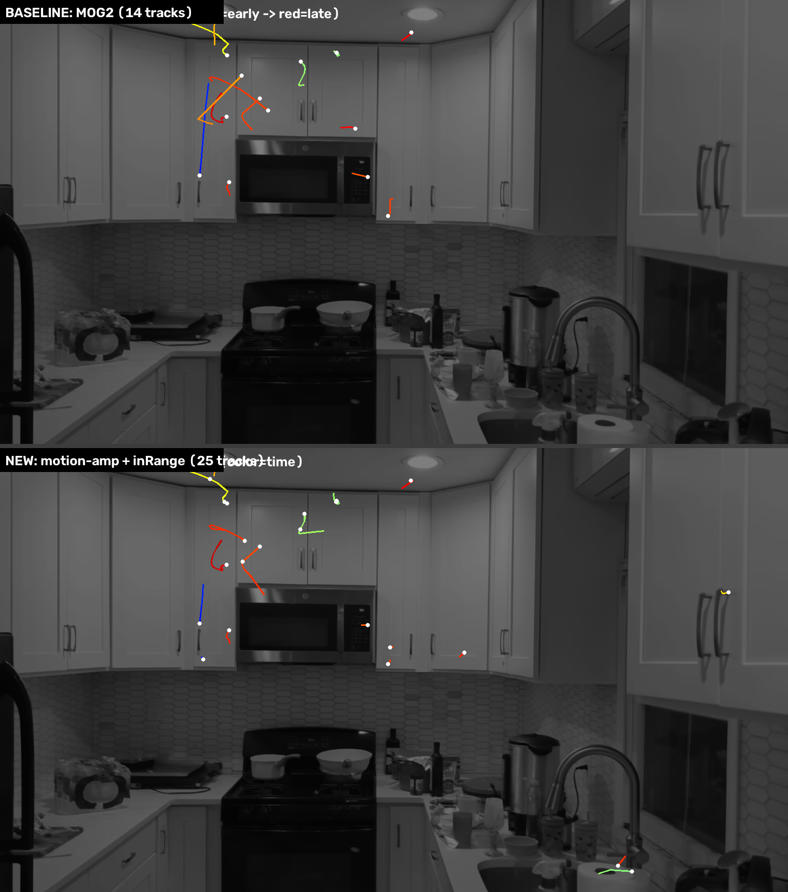

# Experiment 2 — Motion Amplification + `cv2.inRange` tracking

**Goal:** swap the MOG2 background subtractor for a **`cv2.inRange` value/color detector** running on the **motion-amplified** video (the inverted/time-shifted overlay from Experiment 1), keep the **Kalman + Hungarian** tracker, cap blob **sizes** so it ignores edges and big movements, and measure how it compares to the MOG2 baseline on **accuracy** and **speed**.

---

## TL;DR

| Metric | MOG2 baseline | Motion-amp + `inRange` |
|---|---|---|
| Fly tracks | **14** | **25** |
| MOG2 flies recovered | — | **12 / 14 (86%)**, many sub-pixel identical |
| Track-points (total detections kept) | 105 | 184 |
| Detector speed (compute only) | 12.44 ms/frame · **80 fps** | 11.13 ms/frame · **90 fps** |
| Speed vs MOG2 | 1.0× | **1.12× faster** |
| Learned state | per-pixel Gaussian mixture | **none** (just a static mask) |

**Verdict:** `inRange`+motion-amp finds **the same flies** as MOG2 (often on the exact same pixels) and is a bit faster and much simpler/lighter in state — but it is **noisier and more fragmented**: of its 25 tracks, 12 match MOG2 directly and most of the other 13 are **fragments of those same flies** (the motion-amp signal flickers on/off, so one fly breaks into several short tracks), plus a few false tracks on shiny surfaces. MOG2 still gives the cleaner, longer, more complete tracks.



---

## How it works (the pipeline)

1. **Motion amplification** (same as Exp.1, computed straight from frames so the signal isn't crushed by video compression):
   `blend = 0.5·frame(t) + 0.5·(255 − frame(t−3))` → static scene collapses to mid-gray (~127), motion deviates.
2. **Amplify the deviation** (this is the *amplification* in motion-amplification): `amp = 127 + (blend − 127)·GAIN`, `GAIN = 5`. Flies are small and the blend halves their contrast, so without this the signal is too weak for a threshold.
3. **`cv2.inRange` detector** — grab the pixels that left the gray band, both dark and bright (a moving dark fly makes a *dark* spot at its new position and a *bright* ghost at its old one):
   ```python
   mask = cv2.inRange(amp, 0, 95) | cv2.inRange(amp, 160, 255)
   ```
4. **Instability mask** — AND the result with a "keep" mask of pixels that are *not* chronically flickering (built from the per-pixel temporal std). Without this, `inRange` lights up on every jittering edge and the flickering microwave clock. **This is what stops it catching edges**, together with step 5.
5. **Size caps** (exactly what you asked for): keep blobs with area 2–70 px², max side ≤ 14 px, compact (extent ≥ 0.3) and roundish (aspect ≤ 3.5). This rejects long edge streaks and any large/whole-frame movement.
6. **Kalman (constant-velocity) + Hungarian association** — identical tracker to the baseline (45 px gate, 10-frame coast).
7. **Track filter** — keep tracks ≥ 4 hits, span ≥ 5, that actually translate (path ≥ 16 px or net ≥ 12 px).

---

## Accuracy — what the 25 vs 14 really means

- **12 of 14 MOG2 flies are re-found** by an `inRange` track sharing ≥3 frames within 30 px. For many the mean distance is **0.1–0.3 px** — literally the same detections.
- The 2 MOG2 flies it missed were faint/short tracks whose motion-amp signal never crossed the threshold.
- The **13 "extra" `inRange` tracks are mostly fragments**: e.g. MOG2 fly #49 (frames 468–482) shows up as *two* `inRange` tracks (#321 @468–484 and #322 @471–485). The motion-amp signature blinks (a fly moving at constant speed over uniform cabinet sometimes produces too little frame-to-frame change), so a single fly's track breaks into pieces. A handful of the extras are genuine false positives on reflective objects (faucet, kettle).
- **Why:** `inRange`+motion-amp has **no model of the background** — it only sees instantaneous change. MOG2 *learns* each pixel's normal distribution, so it is steadier and bridges the quiet moments, giving longer unbroken tracks.

---

## Speed — is it really lighter/faster?

Measured on 521 frames @ 1518×854, **detector compute only** (video decode excluded, frames pre-loaded, single run — indicative not lab-grade):

- `inRange` + motion-amp: **11.13 ms/frame (90 fps)**
- MOG2: **12.44 ms/frame (80 fps)**
- → **~12 % faster.**

It's faster and *conceptually* much lighter — **no learned per-pixel model, no mixture-of-Gaussians state to store or update**, just a fixed mask and two threshold ops. But the real-world gap is small because the cost isn't the thresholding (that's nearly free); it's the **float blend math** + **connected-components labeling**, which both detectors pay. If you wanted it dramatically faster you'd do the blend in `uint8`/fixed-point and/or downscale.

**Takeaway on "lighter":** yes in memory/state and simplicity; only mildly so in wall-clock here.

---

## Tips / tricks learned

- **Don't run `inRange` on the exported H.264 motion-amp video** — compression crushed the ±gray signal to std 0.5 and the flies vanished. Compute the blend from frames in memory.
- **Amplify before you threshold.** Tiny objects lose half their contrast in the inverted-overlay blend; a gain of ~5 is what makes `inRange` able to see them.
- **`inRange` with no background model is noise-prone.** It *needs* the instability mask + size caps to be usable; those two are doing the heavy lifting of "don't catch edges and giant movements."
- **Catch both dark and bright.** A moving dark object in the inverted overlay leaves a dark spot (now) and a bright ghost (then) — threshold both ends of the gray band.
- **Tracking saves a noisy detector.** Even with ~0.5 false blobs/frame, the move-or-die track filter removes most of them.

---

## Files (this folder only — Experiment 1 is untouched)

- `REPORT_inrange.md` — this file
- `video/06_tracking_inrange.mp4` — inRange tracking overlay
- `figures/paths_inrange.png` — inRange flight paths (color = time)
- `figures/compare_paths.png` — MOG2 vs inRange, side by side
- `scripts/inrange_pipeline.py` — detect (motion-amp + inRange) + benchmark + track + compare
- `scripts/render_inrange.py` — overlay + path-map renderer
- `scripts/cal_inrange2.py` — threshold/gain calibration
- `data/fly_tracks_inrange.json` — the 25 tracks
- `data/compare_inrange.json` — the metrics table above

**Params used:** `K=3` (time shift), `GAIN=5`, dark `<95`, bright `>160`, size 2–70 px² / ≤14 px side, tracker gate 45 px / coast 10.
